# JAVIER RAMOS // FULL STACK DEVELOPER

---

## TECH STACK & ARSENAL

### Core, Backend & Database


### UI Architecture, Tooling & Systems


---

## ACTIVE ARTIFACTS & SYSTEMS

| INDEX | SYSTEM / PLATFORM | ARCHITECTURE & STACK | STATUS |
|:---:|:---|:---|:---:|
| **01** | [**Dra. Andrea Díaz — Clinical Portal**](https://andreadiazmd.com) | **React 19 + Vite + Node.js + Express + PostgreSQL + Drizzle ORM**<br>Plataforma clínica integral de medicina estética y salud. Arquitectura full-stack con diseño editorial responsivo en Tailwind CSS, microinteracciones con Framer Motion, backend Express securizado con Helmet/CORS y persistencia relacional con Drizzle ORM. | `PRODUCTION` |
| **02** | **[CONFIDENTIAL] Local AI Academic & Audio Engine** | **Python + Whisper AI + NVIDIA CUDA + CTranslate2 + FastAPI**<br>Asistente inteligente y motor de transcripción en tiempo real con IA 100% local y offline. Captura de audio de bajo nivel a través de Windows WASAPI Loopback, inferencia acelerada por GPU, síntesis académica estructurada (formato Cornell y normas APA 7) y arquitectura offline-first con privacidad absoluta de datos. | `IN DEVELOPMENT` |

---

## TELEMETRY & RUNTIME STATS

<p align="center">
  
  
</p>

<p align="center">
  
</p>

---

```text
[EOF] -- END OF PROFILE SPECIFICATION
```
